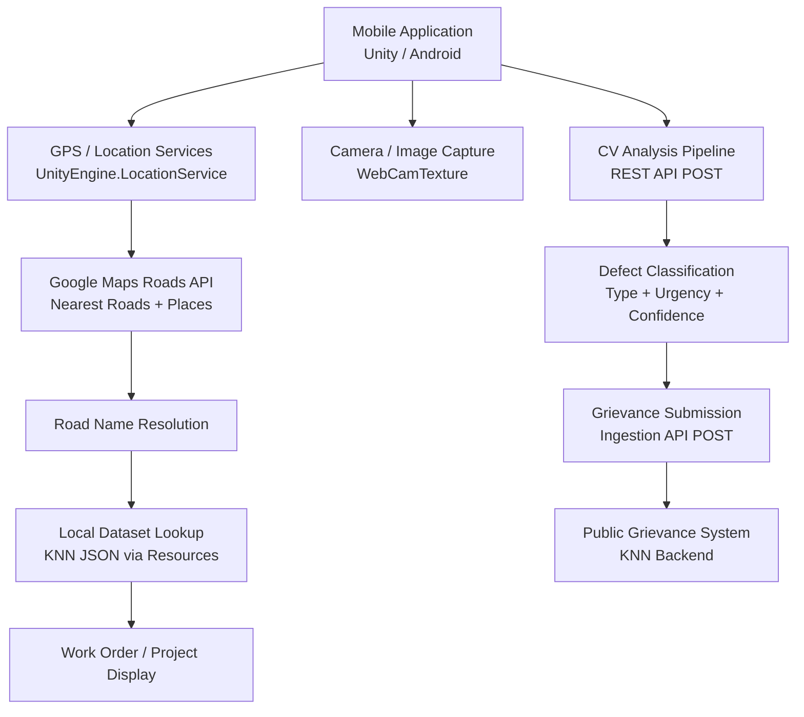
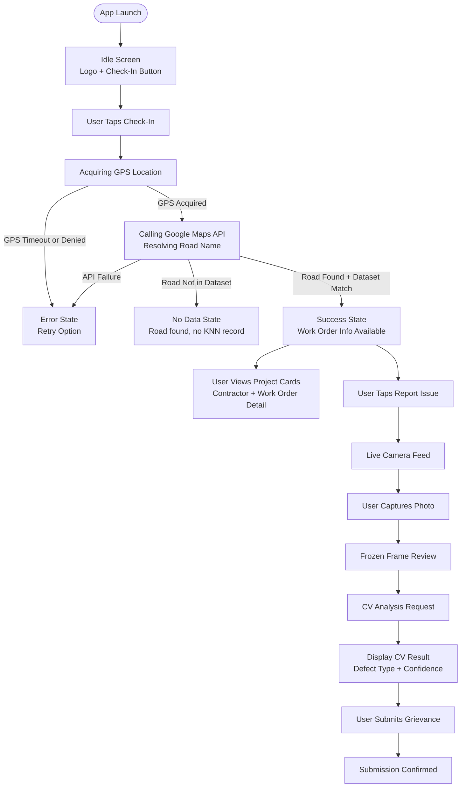
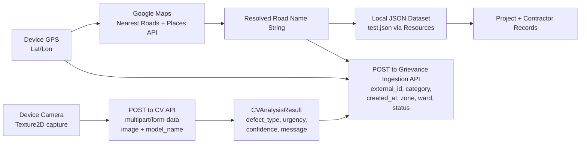

# Functional Requirements Specification
## LocationAR — Civic Infrastructure Reporting Application
**Version:** 0.1 (Prototype)
**Status:** Active Development
**Last Updated:** May 2026
**Prepared for:** Kanpur Nagar Nigam / Engineering Stakeholders

---

## Table of Contents
1. [Introduction and Scope](#1-introduction-and-scope)
2. [Product Positioning](#2-product-positioning)
3. [System Overview](#3-system-overview)
4. [Current Data Sources and References](#4-current-data-sources-and-references)
5. [Current Constraints and Data Limitations](#5-current-constraints-and-data-limitations)
6. [Core Functional Requirements](#6-core-functional-requirements)
7. [Operational Constraints](#7-operational-constraints)
8. [Future Scope and Extensibility](#8-future-scope-and-extensibility)

---

## 1. Introduction and Scope

LocationAR is a mobile application that enables users to retrieve road infrastructure information based on their current device GPS location. Users can capture photographs and submit geo-tagged reports, which are processed through a Computer Vision (CV) analysis pipeline and routed into public grievance management systems for local government departments.

The current prototype implementation uses datasets provided by **Kanpur Nagar Nigam (KNN)**, Uttar Pradesh.

### 1.1 Purpose

LocationAR acts as a crowd-sourced civic infrastructure reporting platform. Citizens can use the application to:

- Report civic infrastructure issues including potholes, road damage, garbage accumulation, stray animals, unauthorised hoardings, and other road-surface or public-space concerns.
- View information about road stretches, contractor work orders, and associated repair or maintenance activities.
- Submit structured complaint data into a grievance management pipeline.

The application is designed to bridge the gap between citizen-observed conditions and formal grievance databases, while providing visibility into the government's existing contractor and work-order landscape.

---

## 2. Product Positioning

### 2.1 What This Application Is

LocationAR is a **civic infrastructure reporting tool**. Its primary function is:

- **Location-contextualised reporting:** A citizen standing on or near a road uses their device GPS to look up relevant government work orders and road stretch information for that location.
- **Geo-tagged complaint submission:** The citizen captures a photograph of an issue, which is analysed by a CV pipeline to categorise the defect, and the resulting structured complaint is submitted to a grievance management system.
- **Work-order and contractor transparency:** The application displays contractor names, work-order budgets, and timelines associated with the identified road stretch.
- **CV-assisted issue categorisation:** Image analysis produces a defect type, confidence score, and a grievance summary, which are presented for user review before submission.

Metadata captured per report includes: captured image, latitude/longitude coordinates, GPS horizontal accuracy, resolved road name, timestamp, and CV-assigned issue category.

### 2.2 What This Application Is Not

| Not This | Clarification |
|---|---|
| Google Maps | The application uses Google Maps APIs for road-name resolution. It does not replicate Google Maps functionality and does not provide navigation, routing, or full-map interaction. |
| Location-based AR gameplay | There are no persistent virtual objects anchored to the real world. This is not a Pokémon GO-style AR experience. AR framing refers to the location-aware, camera-assisted data retrieval workflow. |
| A full GIS platform | The application performs lightweight road-lookup against a structured dataset. It does not provide spatial query, parcel-level GIS, or map layer capabilities. |
| A real-time road condition monitor | Reports are citizen-submitted on demand. There is no automatic background sensing, crowdsourced aggregation engine, or live monitoring feed at this prototype stage. |

---

## 3. System Overview

### 3.1 High-Level Architecture

### 3.2 User Interaction Flow

### 3.3 Data Flow

### 3.4 Major System Components

| Component | Technology | Role |
|---|---|---|
| Mobile Application | Unity 2023.2 / Android | Host application and UI state machine |
| Location Services | `UnityEngine.LocationService` | GPS coordinate acquisition |
| Camera Capture | `WebCamTexture` | Live feed and image capture |
| Road Name Resolution | Google Maps Nearest Roads API → Places API | Convert lat/lon to human-readable road name |
| Local Dataset | JSON file (`test.json`) via `Resources.Load` | KNN work-order and project records |
| CV Analysis Pipeline | REST POST, multipart/form-data | Defect classification from submitted image |
| Grievance Ingestion | REST POST, JSON body | Submit structured complaint record to KNN backend |
| Debug Overlay | On-device UI layer | Runtime logging visible during testing |

---

## 4. Current Data Sources and References

### 4.1 Source Dataset

The application's road-stretch and work-order data is derived from datasets provided by Kanpur Nagar Nigam. The source material describes contractor work orders in terms of:

- **Contractor name and project ID**
- **Road stretch descriptions** using landmark-based Point A → Point B references (e.g., "From [Junction X] to [Junction Y]")
- **Work-order type, budget, and duration**
- **Ward and zone identifiers**

### 4.2 Internal Mapping Workflow

Because the source datasets describe road stretches using landmark references rather than coordinate pairs, the team performed an internal mapping workflow to translate this data into an application-usable form:

1. Landmark pairs from work orders were identified and located using Google Maps.
2. Major road names between listed landmarks were inferred using road continuity and signage conventions.
3. Approximate route alignments were estimated using work-order lengths and visual road-network tracing.
4. Road names were standardised to match the strings returned by the Google Maps Places API for the same area, to enable reliable lookup matching.

This workflow represents a best-effort translation of administrative records into geo-resolvable road identifiers. It is an operational necessity given the absence of coordinate-level GIS data in the source material.

---

## 5. Current Constraints and Data Limitations

### 5.1 Dataset Ambiguity

The source datasets contain inherent ambiguity that limits mapping precision:

- Landmark references in work orders are descriptive rather than coordinate-based, and the same landmark name may refer to different physical locations depending on context.
- Work-order lengths and road continuity can support approximate route alignment but cannot guarantee exact boundary placement.
- Multiple work orders may partially overlap on the same road stretch, and de-duplication was applied on a best-effort basis.

These are limitations of the available source data, not failures of the application. Accurate road-stretch alignment would require verified, on-ground data collection.

### 5.2 Positional Accuracy

The current dataset does not include verified latitude/longitude coordinates for road boundaries. As a result:

- There is potential positional error in which work-order records are associated with a given GPS reading.
- Near-boundary GPS readings (i.e., a user standing at the edge of two road stretches) may resolve to an adjacent record.
- Accurate resolution at sub-50-metre granularity would require on-ground field validation and a standardised municipal mapping workflow.

### 5.3 GPS Accuracy

Device GPS accuracy directly affects application reliability:

- The application uses `desiredAccuracyInMeters = 100f` and `updateDistanceInMeters = 5f` by default, balancing accuracy against battery drain on mobile hardware.
- In areas with poor satellite visibility (dense urban canyons, indoors), GPS accuracy may degrade significantly.
- Horizontal accuracy is captured and stored with each report but is not currently used to gate submission.

### 5.4 Connectivity and API Dependencies

| Dependency | Impact if Unavailable |
|---|---|
| Internet connection | Application cannot resolve road names or submit reports |
| Google Maps Roads API | Road-name resolution fails; application enters error state |
| Google Maps Places API | Road name cannot be resolved even if a `placeId` is returned |
| CV Analysis API | Defect classification unavailable; complaint submission may still proceed |
| Grievance Ingestion API | Report cannot be submitted to KNN backend |

### 5.5 Device Compatibility

Android hardware fragmentation means that not all devices produce consistent behaviour. Confirmed incompatibility was observed on Redmi Note 8 and POCO M6. The application functions correctly on Google Pixel 7 (Android 13, stock). Likely contributing factors on incompatible devices include:

- **OEM permission handling:** Xiaomi devices running MIUI/HyperOS apply aggressive battery optimisation and custom background-process restrictions that can silently revoke or throttle location and camera access after an initial grant, bypassing standard Android permission flow.
- **Camera2 API conformance:** Budget and mid-range devices may only partially implement the Camera2 API. Unity's `WebCamTexture` depends on consistent camera device enumeration and frame delivery; incomplete driver implementations can cause the camera feed to fail to initialise or return zero-size frames.
- **GPS hardware quality and time-to-fix:** Lower-tier GNSS chips may take significantly longer to acquire a fix, or may not sustain the accuracy level required within the application's initialisation timeout window.
- **Android OS version:** The Redmi Note 8 shipped on Android 9, which has different runtime permission behaviour and background location restrictions compared to the Android 13 environment used during successful testing. Some permission-flow assumptions in the application may not hold on older OS versions.
- **OpenGL ES driver stability:** Differences in GPU driver maturity between Adreno 506 (Redmi Note 8) and the Tensor G2 (Pixel 7) can affect Unity's rendering pipeline, particularly around texture formats used by `WebCamTexture`.

These device classes are currently treated as unsupported configurations for this prototype.

---

## 6. Core Functional Requirements

### 6.1 Location Retrieval

- The application shall request runtime location permission on Android.
- The application shall initialise `LocationService` and wait up to a configurable timeout for a valid GPS fix.
- On successful fix, the application shall capture a `LocationSnapshot` containing: latitude, longitude, horizontal accuracy, and timestamp.
- The application shall expose GPS accuracy status (Good / Fair / Poor) for display to the user.

### 6.2 Road Name Resolution

- On receiving a valid `LocationSnapshot`, the application shall submit the coordinates to the Google Maps Nearest Roads API to retrieve a `placeId`.
- The application shall then call the Google Maps Places API with the returned `placeId` to resolve a human-readable road name.
- If the API returns no result, the application shall display: *"Unable to detect road. Please try again."*
- The resolved road name shall be used as the lookup key against the local dataset.

### 6.3 Work-Order and Project Lookup

- The application shall load the KNN dataset from a bundled JSON resource file at startup.
- On receiving a resolved road name, the application shall query the dataset for matching road entries and their associated project records.
- If the road is found but has no dataset entry, the application shall display: *"This road is not yet included in the government database."*
- If multiple project records are matched, the application shall display the full list. Auto-selection of a single record is not permitted.
- Project cards shall display contractor name, project ID, work-order type, budget, and relevant dates where available.

### 6.4 Image Capture

- The application shall access the device camera via `WebCamTexture` and display a live camera feed.
- The user shall be able to capture a still frame for review before submission.
- The captured image shall be retained in memory as a `Texture2D` for submission to the CV pipeline.
- The user shall be able to retake the photo before proceeding.

### 6.5 CV-Assisted Issue Categorisation

- On user confirmation of a captured image, the application shall encode the image as a JPEG and POST it to the CV analysis endpoint as `multipart/form-data`, including the selected model identifier.
- The CV response shall be parsed into a `CVAnalysisResult` containing: `defect_type`, `urgency`, `confidence`, and `message`.
- The result shall be displayed to the user for review before grievance submission is enabled.
- If the CV API call fails, the application shall allow the user to proceed with complaint submission using available metadata, as the CV result is not a blocking dependency for grievance submission.

### 6.6 Metadata Tagging

Each submitted report shall be tagged with the following metadata at time of submission:

| Field | Source |
|---|---|
| `latitude` | `LocationSnapshot` |
| `longitude` | `LocationSnapshot` |
| `horizontal_accuracy` | `LocationSnapshot` |
| `timestamp` | `LocationSnapshot` (ISO 8601) |
| `road_name` | Google Maps Places API result |
| `category` | CV `defect_type` result |
| `external_id` | Application-generated prefix + Unix timestamp |

### 6.7 Grievance Submission

- On user confirmation of the CV result, the application shall POST a structured `IngestionComplaintRecord` to the grievance ingestion API.
- The payload shall include: `external_id`, `created_at`, `category`, `status`, `lat/long`, `horizontal accuracy`, `roadName`.
- The application shall display a loading indicator during submission and a confirmation screen on success.
- On failure, the application shall report the error and allow the user to retry without re-capturing the image.

---

## 7. Operational Constraints

| Constraint | Description |
|---|---|
| Internet connectivity | Required for road-name resolution, CV analysis, and grievance submission. Offline mode is not supported. |
| Location permission | Android `ACCESS_FINE_LOCATION` permission must be granted at runtime. Denial places the application in an error state. |
| GPS availability | A valid outdoor GPS fix is required. Indoor or low-accuracy environments reduce reliability. |
| Google Maps API quota | Road-name resolution is subject to Google Cloud API quotas and billing. Each Check-In consumes one Nearest Roads call and one Places Detail call. |
| CV API availability | The CV classification endpoint is a third-party service. Availability is not under the application team's control. |
| Grievance API availability | The ingestion endpoint must be reachable. Submissions cannot be queued offline at this prototype stage. |
| CV classification uncertainty | Confidence scores below a threshold should be surfaced to the user. The CV result is a classification aid, not a verified assessment. |
| Device hardware fragmentation | Behaviour on Android devices with limited camera APIs or ARCore support below the expected tier is not guaranteed. |

---

## 8. Future Scope and Extensibility

The following directions are noted as possibilities based on the current architecture. They are not committed features and no delivery timeline is implied.

### 8.1 GIS-Backed Dataset

The current landmark-referenced dataset could be replaced or supplemented with a GIS-annotated dataset containing verified coordinate boundaries for each road stretch. The architecture supports this: `LocationJSONLoader` is a thin data layer and could be adapted to load from a coordinate-keyed structure without changes to the UI or submission pipeline.

### 8.2 On-Ground Validation Workflow

Future implementations may enable a field-survey mode in which KNN officers or contractors verify and annotate road boundaries at the device level, producing a validated coordinate dataset. This would eliminate the positional ambiguity inherent in the current landmark-derived mapping.

### 8.3 Contractor Accountability Workflows

The system is modular enough to integrate complaint-submission timestamps with work-order start and end dates from the dataset, allowing correlation of citizen-reported issues against the contractual maintenance window for a given road stretch. This could support basic contractor accountability reporting.

### 8.4 Improved CV Classification

The CV pipeline currently operates in single-shot classification mode. The architecture could support multi-label classification (e.g., simultaneous pothole + garbage detection), severity grading, or model selection per issue category, given an updated CV API contract.

### 8.5 Standardised Municipal Mapping

If Kanpur Nagar Nigam or a state-level GIS authority publishes a standardised, coordinate-accurate road dataset aligned to the road names returned by Google Maps APIs, the application's lookup accuracy could be significantly improved with minimal changes to the data layer.

---

*This document describes the current state of a working prototype. It is intended as an engineering reference for active development, stakeholder review, and handover. Sections 5 and 7 describe real operational constraints; they should not be considered defects pending resolution, but boundaries within which the current system operates.*
